# groundeffect-ml

[](https://github.com/danielbruno77/groundeffect-ml/actions/workflows/ci.yml)
[](https://github.com/danielbruno77/groundeffect-ml/actions/workflows/model.yml)

**From OpenFOAM to a gated, deployed PyTorch surrogate, for a wing in ground effect.**

A compact, end-to-end reference for ML on CFD data in race-car aerodynamics. Every stage is the real thing at laptop scale, and every stage runs in CI:

- parametric geometry
- automated hybrid meshing
- QA'd RANS data generation with automatic solver recovery
- solution verification (GCI)
- surrogates with calibrated uncertainty (GP, PyTorch deep ensemble, NVIDIA PhysicsNeMo MeshGraphNet)
- wind-tunnel drift and anomaly detection
- CI/CD that gates and ships the model

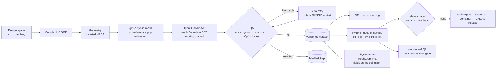

## The case

A single-element inverted wing above a moving ground: a front-wing proxy in the spirit of Zerihan & Zhang (*J. Aircraft*, 2000).

- **Flow:** chord 0.3 m, 25 m/s, Re = 5×10⁵; incompressible steady RANS, k-ω SST, Spalding wall function at wing y+ ≈ 1–4, rolling road, slip roof.
- **Design variables:**
  - ride height h/c ∈ [0.08, 0.6], sampled log-uniformly because the non-linearity lives at low h;
  - nose-down incidence 0–8°;
  - NACA camber 2–6%;
  - thickness 9–15%.

| Mesh | Solution |
|---|---|
| 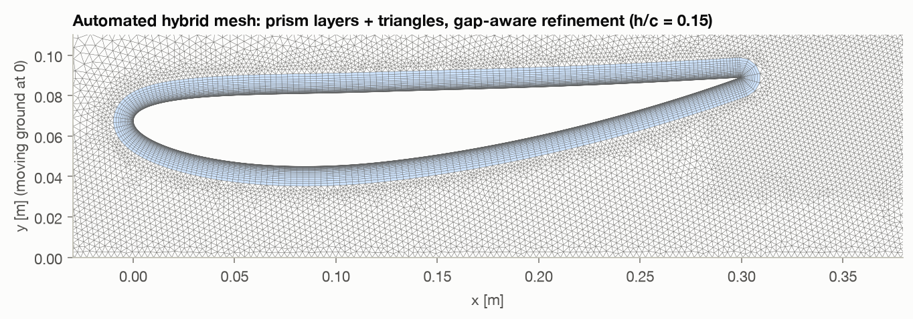 | 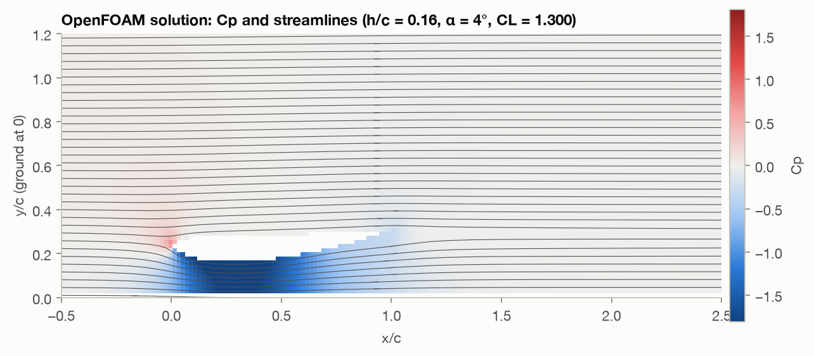 |

## Results

**Data.** The DOE has 304 OpenFOAM cases: 256 Sobol training cases and 48 independent Latin-hypercube test cases.
- 235 converged first time.
- The automatic recovery step rescued 45 of the 69 that did not.
- **280 cases are usable** (235 train / 45 test). The remaining 24 are genuinely unsteady low-ride-height flows, which are kept and labelled, not trained on.

**Surrogate on the held-out test design** (dataset `c9158e509306`, every [gate](configs/gates.yaml) passed):

| | PyTorch deep ensemble | Gaussian process | CFD noise floor (GCI) |
|---|---|---|---|
| CL (downforce) RMSE | **0.0047** (R² 0.9997, MAPE 0.33%) | 0.0041 | 0.013 |
| CL 2σ coverage | 89% | 98% | |
| CL pair-sign accuracy¹ | **100%** of 939 pairs | | |
| CD MAPE | 0.49% | 0.35% | |
| surface Cp RMSE | 0.0087 (10 POD modes, 99.97% energy) | n/a | |

¹ Over pairs of designs whose true ΔCL exceeds twice the CFD noise floor: does the model rank the variants the same way as CFD? This is the number a design decision actually uses.

Both surrogates are about **3× more accurate than the CFD's own discretisation uncertainty**, so the bottleneck is now CFD fidelity, not the model.
- On the four scalars, the GP is slightly more accurate and better calibrated.
- The ensemble earns its place by predicting the whole Cp distribution, and as the base for field models.

| Held-out test design | Surface Cp, best / median / 95th-percentile case |
|---|---|
| 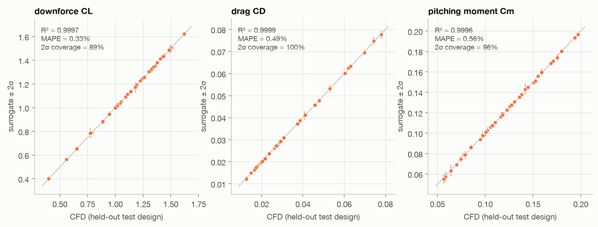 | 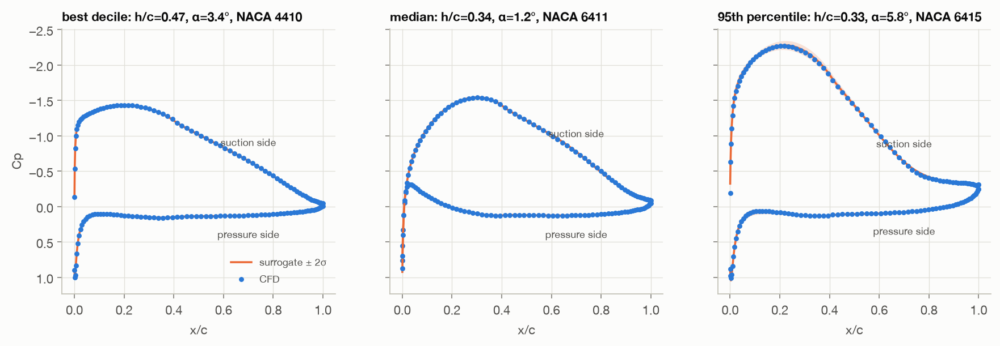 |

**Physics check on an unseen ride-height sweep.** Ten new CFD runs at one configuration, none of them in training:
- Downforce rises as the gap closes, peaks near h/c ≈ 0.17, then falls. This is the classic ground-effect force-reduction regime, where the suction-side boundary layer can no longer sustain the pressure recovery.
- Both surrogates track all ten points to within 0.005 in CL.
- Outside the trained domain the ensemble's σ grows 18× at h/c = 0.05, and the API flags the request as extrapolation.

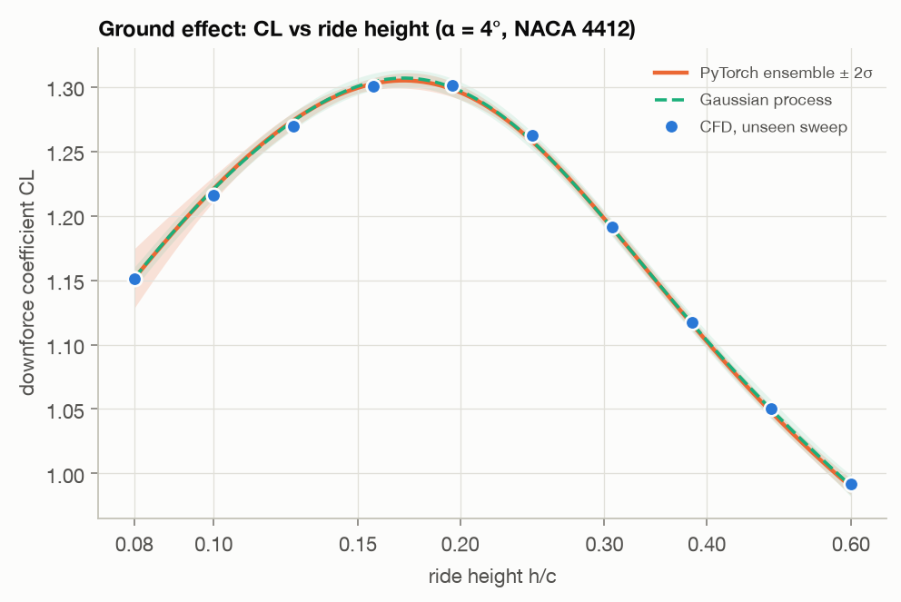

**CFD budget.**
- A GP trained on actively selected cases (max predictive σ, batched with the kriging believer) reaches the CFD noise floor after **48 runs**, against 60 for Sobol or random ordering. That is 20% fewer solves for the same accuracy.
- At 96 runs its error is 30–40% lower.
- Under the FIA Aerodynamic Testing Restrictions, every solve is allocation.

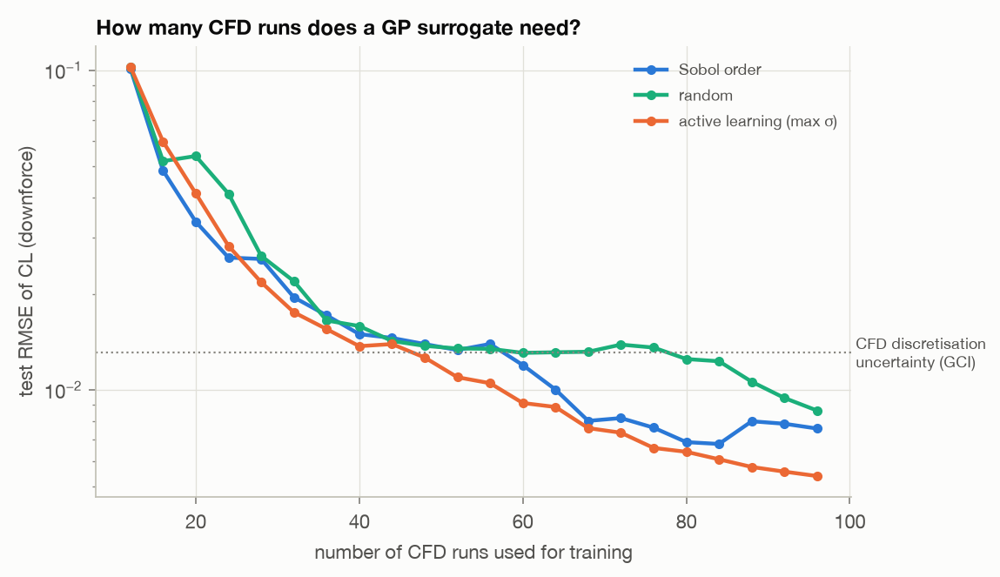

**Field surrogate.** NVIDIA PhysicsNeMo's MeshGraphNet runs directly on the OpenFOAM cell graph: about 42k nodes per case, with the mesh's internal faces as edges.
- **Inputs and outputs.** Node inputs are position, wall distance and the design variables; outputs are u, v and Cp at every cell.
- **Training.** 96 training cases, 25 epochs, CPU only, about 25 min.
- **Accuracy on all 45 unseen test designs.** Median relative L2 error is **2.7% for u and 6.1% for Cp** (90th percentile 4.4% and 9.3%). The error concentrates at the suction-side leading-edge peak, which is where a refinement or more training data would go.
- **Two backends.** A pure-PyTorch implementation of the same architecture, with an identical parameter count that a test checks, runs where PhysicsNeMo's graph stack is not installed.

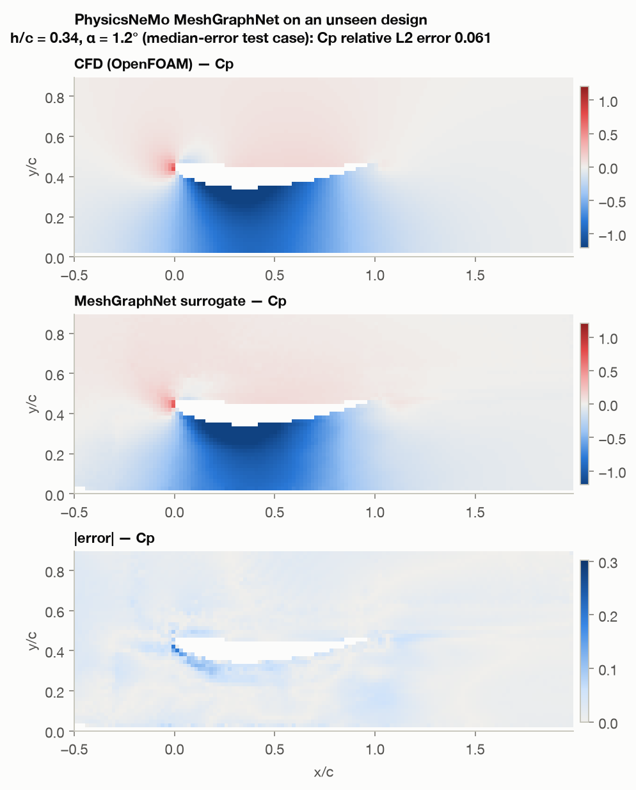

**Wind-tunnel QA** (details [below](#wind-tunnel-data-qa)).
- Across six random campaigns every injected fault was detected (recall 1.0 for all five fault types).
- Drift and step flags had precision 1.0.
- A +2.5% calibration drift was caught at the first datum run after onset, when it had reached about 0.5%.
- The learned CFD→tunnel correlation recovers the injected one (k = 0.959 vs 0.96).

## Solution verification first

The surrogate can only be as good as its data, so the CFD is verified before any ML.

The method is a three-level grid convergence study with refinement ratio √2 in cell size (Celik et al. 2008), at three ride heights.

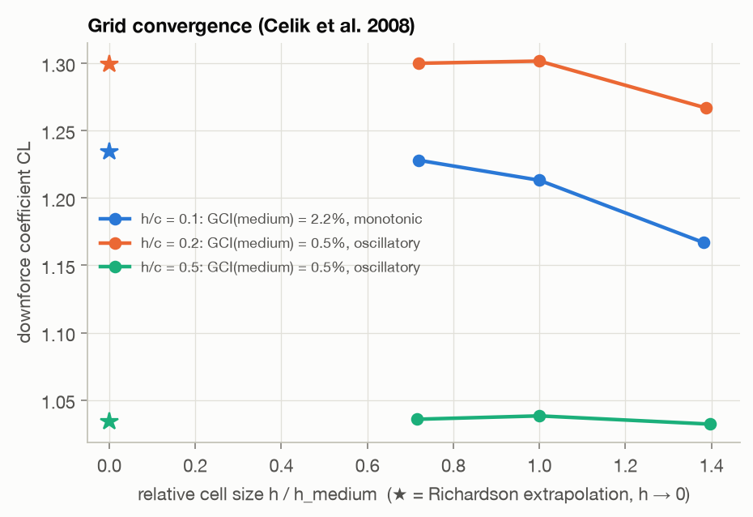

What the study found, in order:

1. **v0 mesh, prism layer too thin.** CL at h/c = 0.2 converged *oscillatorily* with GCI = 8%. The prism layer covered 1.2% of chord, but the turbulent boundary layer at the trailing edge is about 3–4% at this Re. The outer boundary layer and the near wake were resolved by a couple of triangles.
2. **v1 mesh, BL-sized layers.** The layers are now sized from BL physics and capped at 40% of the gap at low ride height, the triangles match the last layer, and a near-wake refinement box was added. GCI(medium) dropped to **0.5%** at h/c = 0.2 and 0.5.
3. **Low ride height (h/c = 0.10).** The coarse and medium meshes fell into a ±2% **numerical limit cycle** under SIMPLEC. QA flagged them. A restart with plain SIMPLE and stronger under-relaxation converged, which proves the cycle is numerical and not physical unsteadiness. That restart is now an automatic recovery step in the pipeline. The converged family gives GCI(medium) = **2.2%**.

The medium-mesh GCI is the **numerical noise floor**. Model gates are read against it: a surrogate error below the CFD's own discretisation uncertainty is noise-chasing. The data behind the figure is in [`data/grid_study.json`](data/grid_study.json), and the v0 study is kept in [`data/grid_study_v0_thin_prism_layer.json`](data/grid_study_v0_thin_prism_layer.json).

## Data QA: nothing is silently dropped

Every case writes `result.json` with:

- integrated loads averaged over the last 300 iterations;
- relative std and drift of CL over that window (the convergence verdict);
- checkMesh metrics and y+ statistics;
- wall time and status.

The status is one of `ok`, `unconverged`, `mesh_failed` or `solver_failed`. `unconverged` cases are retried once with the robust profile, and only `ok` cases reach training. Rejected cases stay in [`data/dataset/cases.csv`](data/dataset/cases.csv) as data about where steady RANS stops being trustworthy. They cluster at low ride height and high incidence, exactly where massive suction-side separation is expected.

The smoke test also checks that the integral of the surface Cp matches OpenFOAM's force integration, which catches sign, frame and normalisation errors early.

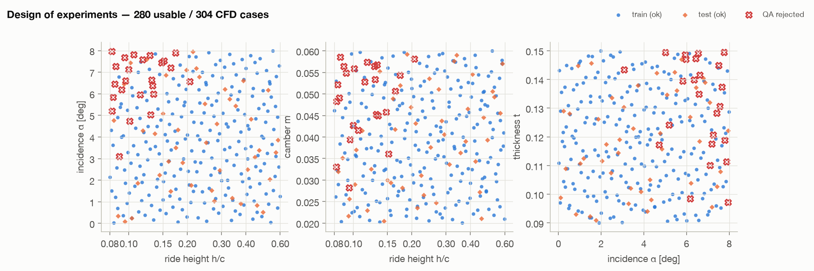

## Wind-tunnel data QA

Tunnel data is confidential, so the detectors are developed against a simulator. It injects realistic faults with ground truth: calibration drift, a balance-zero step, spikes, a blocked pressure tap, and a mis-set configuration.

The key design choice is to **monitor residuals, not raw loads.** The detectors monitor measured CL minus the surrogate prediction, after a CFD→tunnel correlation (Huber fit) learned on a trusted baseline. Configuration changes then stop looking like anomalies.

| Detector | Catches |
|---|---|
| Hampel filter on residuals (baseline σ) | spikes |
| Shewhart + EWMA + CUSUM on datum (check-standard) runs, reset after alarm | drift, steps |
| PELT change points on run means | *when* a level change began |
| robust isolated-run test | one configuration that disagrees with the model |
| PCA reconstruction error per tap | blocked or leaking taps |

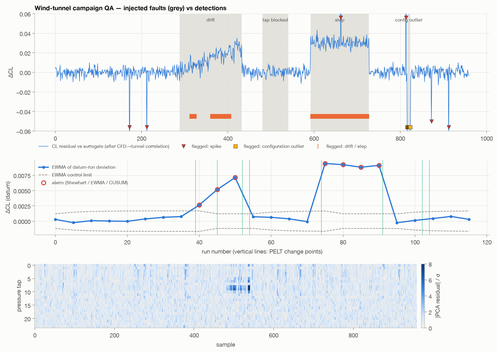

## CI/CD

| Workflow | What it proves |
|---|---|
| [`ci.yml`](.github/workflows/ci.yml) `lint` | ruff, formatting, mypy |
| `test` | 50 unit/integration tests: geometry, meshing, OpenFOAM parsers on real solver output, GCI against an analytic solution, models, `torch.export` parity, detectors on injected faults, the HTTP API |
| `cfd-smoke` | **a real OpenFOAM case in CI**: gmsh → gmshToFoam → simpleFoam (official OpenCFD image) → QA, asserted against physical bounds and the Cp-vs-force consistency check |
| [`model.yml`](.github/workflows/model.yml) `train` | trains on the versioned dataset and applies [`configs/gates.yaml`](configs/gates.yaml); a failing gate fails the build and nothing is promoted. Gate table goes to the job summary |
| `image` | builds the CPU-only inference image with the gated `torch.export` program baked in; smoke-tests `/health` and `/predict` in the container; pushes to GHCR |
| `release` | on a `v*` tag: GitHub release with the model and its [model card](artifacts/model_card.md) |

The OpenFOAM runner is the same code on a laptop (Docker, arm64), in Actions (Docker, amd64) and on an HPC node with a native install (`--mode native`).

## Quick start

```bash
uv sync --extra cfd          # Python 3.12, locked; gmsh for meshing
docker pull opencfd/openfoam-default:2512
uv run pytest                # ~25 s
uv run groundeffect smoke    # one coarse CFD case end to end, ~10 s
uv run groundeffect train    # GP + ensemble on the committed dataset, gates, export
uv run groundeffect serve    # http://127.0.0.1:8000/docs
```

Reproduce the data (about 2 h on a 14-core laptop, most of it the 304-case DOE):

```bash
make grid doe retry dataset train sweep wt figures
uv sync --extra physicsnemo  # PhysicsNeMo; on macOS also build torch-scatter from source
make mgn
```

Example request:

```bash
curl -s localhost:8000/predict -H 'content-type: application/json' -d '{"designs":[{"h_c":0.12,"alpha_deg":5,"camber":0.05,"thickness":0.12}],"include_cp":false}'
```

## Layout

```
src/groundeffect/
  geometry.py        inverted NACA section, incidence, ride height, Cp stations
  meshing.py         gmsh hybrid mesh, physics-sized prism layers, refinement fields
  foam/case.py       OpenFOAM case writer (BCs, SST, SIMPLEC / robust SIMPLE)
  foam/runner.py     native or Docker execution
  foam/parse.py      force/residual tables, checkMesh, y+, ASCII fields, mesh graph
  pipeline.py        run → QA → retry → fields; batch runner
  verification.py    Celik GCI
  doe.py             design space, Sobol / LHS
  models/            data + POD, GP + active learning, PyTorch ensemble + export,
                     PhysicsNeMo MeshGraphNet, evaluation + gates
  windtunnel/        campaign simulator with injected faults, detectors
  serve.py           FastAPI service over the exported program
  cli.py, report.py  commands and figures
```

## Limitations and what changes at full scale

- **2D sections.** No tip vortices, endplates or 3D relief: these are trends, not car numbers. The skeleton is unchanged in 3D; the expensive parts become the mesh and the data loader.
- **Steady RANS** is not trustworthy for massively separated low-ride-height cases. QA rejects them and the model's valid domain says so. At scale these need scale-resolving CFD, or heteroscedastic models that learn where the data is noisy.
- **At full scale:**
  - aeromaps over front/rear ride height, roll, yaw and both active-aero states;
  - geometry-native models (DoMINO, Transolver, X-MeshGraphNet) on surface point clouds;
  - sizing fields learned from an archive of approved meshes;
  - conformal prediction intervals;
  - tunnel QA with covariate (temperature, belt, tyre) normal-behaviour models.
